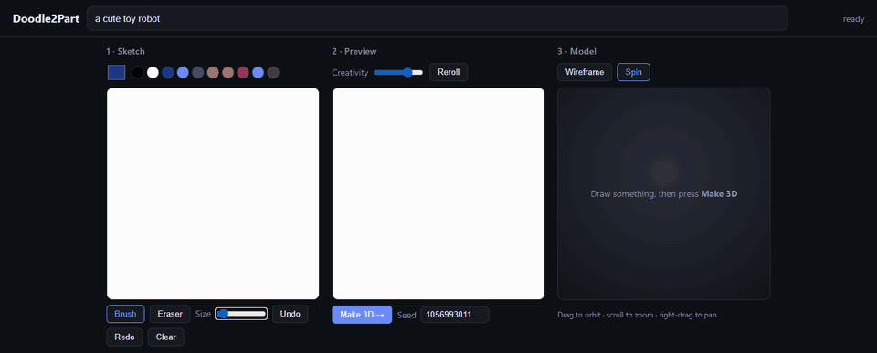

# Doodle2Part

**Draw a doodle, get a 3D model.** A live AI preview turns your sketch into a clean product shot as you draw. One click turns that into a colored 3D mesh you can rotate in the browser and download as `.glb`.

Everything runs locally on one consumer GPU. No API keys, no cloud, and your sketches never leave your machine.



<sub>Real recording from an RTX 3090 (`scripts/record_demo.py`). The ~17 s 3D build is sped up; drawing and the live preview play at real speed.</sub>

## How it works

```
 Sketch (canvas)
    │  every stroke, over a WebSocket (newest frame wins)
    ▼
 SD-Turbo img2img, 1 step, ~50 ms ──► live preview: "single object, plain white background, 3d render"
    │  "Make 3D"
    ▼
 rembg (background removal) ──► TRELLIS image-to-3D ──► FlexiCubes mesh, ~450k faces, per-vertex color
    │
    ▼
 quadric decimation to 100k faces (colors kept) ──► .glb ──► three.js viewer
```

- **The preview is the bridge between the sketch and 3D.** Image-to-3D models expect a clean photo of one object, not line art. SD-Turbo redraws the sketch as one, with a fixed prompt suffix asking for a single centered object on a plain background. Because it updates on every stroke, you see what will be converted before you press the button.
- **Runs on native Windows without the CUDA toolkit.** Normally TRELLIS needs Linux and several CUDA extensions compiled from source. Here it uses xformers attention and spconv's prebuilt wheels. `kaolin` is stubbed, because FlexiCubes only uses it for an input check. Texture baking needs `nvdiffrast`, so it's skipped, and the mesh keeps TRELLIS's per-vertex colors instead. See [`m0/M0_REPORT.md`](m0/M0_REPORT.md) for how this was worked out.
- **Light enough for the browser.** Raw TRELLIS meshes (~450k faces) are decimated to 100k faces with Open3D. The colors are kept, and the result is a ~2 MB `.glb`. three.js is stored in the repo, so the UI works offline too.
- **One GPU, two models.** Both stay loaded (TRELLIS peaks around 10 GB, SD-Turbo adds ~3 GB). A lock makes the live preview pause briefly while a 3D job runs.

## Performance (RTX 3090, Windows 11)

| Step | Time |
|---|---|
| Live preview frame (SD-Turbo, 1 step, TAESD) | ~50 ms |
| Make 3D (rembg + TRELLIS + decimation + GLB export) | ~15–19 s |
| First launch (model downloads, ~7 GB) | a few minutes, once |

## Install

Requirements: an NVIDIA GPU (tested on an RTX 3090 24 GB; 16 GB+ recommended, smaller cards untested), Python 3.11 and [uv](https://docs.astral.sh/uv/). Tested on native Windows 11. Linux should work but hasn't been tried.

```bash
git clone https://github.com/DylanMartinLSC/doodle2part.git
```

```bash
cd doodle2part
```

```bash
uv venv --python 3.11 .venv
```

```bash
uv pip install --python .venv/Scripts/python.exe torch==2.5.1 torchvision==0.20.1 xformers==0.0.28.post3 --index-url https://download.pytorch.org/whl/cu124
```

```bash
uv pip install --python .venv/Scripts/python.exe -r requirements.txt
```

```bash
git clone --recurse-submodules https://github.com/microsoft/TRELLIS.git third_party/TRELLIS
```

On Linux, use `.venv/bin/python` instead of `.venv/Scripts/python.exe`. The versions in `requirements.txt` are pinned on purpose: newer `diffusers` needs `huggingface_hub>=1`, which the `transformers` version TRELLIS works with rejects.

## Run

```bash
.venv/Scripts/python.exe server.py
```

Open http://127.0.0.1:7861. The first launch downloads the model weights (~7 GB, cached afterwards).

- **Draw** on the left. B/E switch brush and eraser, `[` and `]` change the size, Ctrl+Z / Ctrl+Shift+Z undo and redo. You can also paste or drop an image to draw over.
- **Type what it is** in the prompt box. **Creativity** controls how far the preview may stray from your lines, and **Reroll** tries a new seed.
- **Make 3D** (or Ctrl+Enter) converts the current preview. In the viewer, drag to orbit, scroll to zoom, and toggle **Wireframe** and **Spin**. **Download .glb** saves the model. Every result is also saved in `outputs/`.

Options:

```bash
.venv/Scripts/python.exe server.py --mock
```

`--mock` runs the whole UI without loading any models, which is useful for frontend work. `--faces N` changes the decimation target (default 100,000), and `--port` / `--host` work as usual.

## Limitations

- **Vertex colors, not textures.** Colors are stored per vertex, so fine detail like small text comes out blurry. Baked textures would need `nvdiffrast` compiled, which requires the CUDA toolkit.
- **One object per drawing.** The pipeline assumes a single object; scenes with several objects don't convert well.
- **The preview is what gets converted.** If the preview misreads your sketch, the 3D model will too. Reroll or adjust Creativity first.

## Roadmap

Next is **CAD mode** for mechanical parts. A local vision model (Qwen3-VL via Ollama) reads a dimensioned sketch and writes a CadQuery script, which runs in an isolated subprocess with a retry loop. The output is an editable STEP/STL with a slider for each dimension. The feasibility test worked: the scripts run, but the local 8B model places features wrong. See [`PLAN.md`](PLAN.md) and the [M0 report](m0/M0_REPORT.md) for the plan to fix that (better examples, a geometric check, a bigger model, and a test set of sketches).

## Credits and licenses

Doodle2Part's own code is MIT licensed (see [LICENSE](LICENSE)). It builds on:

| Component | License |
|---|---|
| [TRELLIS](https://github.com/microsoft/TRELLIS) code and `TRELLIS-image-large` weights (Microsoft) | MIT |
| [SD-Turbo](https://huggingface.co/stabilityai/sd-turbo) (Stability AI) | Stability AI Community License: read it before any commercial use |
| [TAESD](https://github.com/madebyollin/taesd) | MIT |
| [DINOv2](https://github.com/facebookresearch/dinov2) (loaded by TRELLIS) | Apache 2.0 |
| [rembg](https://github.com/danielgatis/rembg) / U²-Net | MIT / Apache 2.0 |
| [three.js](https://threejs.org) (vendored in `static/vendor/`) | MIT |

Model licenses are set by their authors and can change, so check each model card before shipping anything built on this. The sketch canvas and live-preview loop come from my earlier project, [SketchLive](https://github.com/DylanMartinLSC/sketchlive-krea-alternative).
